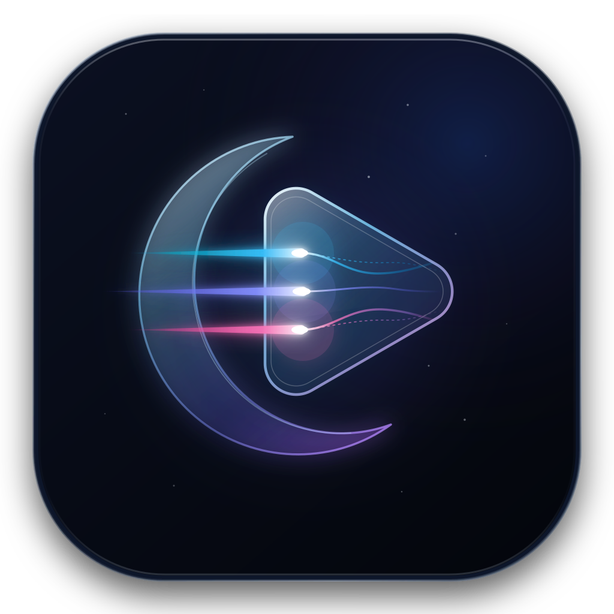

<div align="center">
  
  <h1>Nocta · 夜幕</h1>
  <p><strong>暗色沉浸式私人影院 · 银幕与弹幕的双重盛宴</strong></p>
  <p>专为 Emby / Jellyfin 打造的现代化轻量级桌面客户端，集成全网弹幕自动匹配与彩色渲染引擎</p>

  <p>
    <a href="https://github.com/wade6716/Nocta/actions/workflows/ci.yml"></a>
    <a href="https://github.com/wade6716/Nocta/releases"></a>
    <a href="https://tauri.app/"></a>
    <a href="https://react.dev/"></a>
    <a href="https://www.typescriptlang.org/"></a>
    <a href="https://www.rust-lang.org/"></a>
    <a href="LICENSE"></a>
    
  </p>
</div>

---

## 📖 简介 (Introduction)

**Nocta**（/ˈnɒktə/，拉丁语 *Nox*，意为“夜晚”；中文名 **“夜幕”**）是一款专为追求极致视听与观影氛围的影迷打造的开源桌面播放器客户端。

中文“夜幕”一语双关——既是暗色模式下深邃沉浸的深夜私人影院，又巧妙融合了**“银幕”与“弹幕”**。

在传统 Emby/Jellyfin 客户端中，观看番剧、动画与电影往往缺乏互动与氛围。Nocta 彻底打破了流媒体服务器与全网弹幕生态之间的壁垒，在保持原生桌面级极低资源占用的同时，带来了开箱即用的全网弹幕自动匹配、手动搜索换绑与绚丽的彩色弹幕平滑渲染。

---

## ✨ 核心特性 (Key Features)

### 🎬 1. 沉浸式暗色私人影院
- **深色美学**：针对夜间观影深度调校的纯黑与微光质感 UI，消除刺眼白边，打造影院级沉浸感。
- **现代无边框窗口**：优雅的半透明毛玻璃导航栏，结合原生窗口控制与平滑路由过渡。
- **多端设备记忆**：自动记住并恢复上次连接的 Emby 服务器，多节点即时无缝切换。

### 💬 2. 全网全弹幕生态（Danmaku）
- **客户端纯粹去捆绑**：客户端坚决不内置或打包任何服务端程序，作为轻量纯 HTTP 消费者运行。
- **Token 路径化规范**：Token 直接嵌入在服务 URL 中（如 `http://127.0.0.1:9321/87654321` 或 `http://vps:9321/my_token` ），安全极简。
- **智能自动匹配**：播放时通过影视番剧名称、季数、集数及文件名自动请求匹配弹幕。
- **手动搜索与剧集绑定**：内置弹幕搜索面板，支持按剧名任意搜索全网剧集并一键绑定到当前视频，配置本地持久化记忆。
- **硬件加速渲染**：基于 Canvas 渲染器深度驱动，高帧率平滑滚动无卡顿。
- **色彩与显示控制**：
  - **色彩模式**：多彩弹幕（保留源站全彩特效）、纯白模式、屏蔽彩弹模式。
  - **全方位调节**：弹幕行数限制、不透明度、字体大小、速度调节。
  - **时间轴微调（Offset）**：按单集记忆的时间偏移控制，精准对齐音画与弹幕。

### 📺 3. 智能媒体库过滤与聚合
- **严格视频媒体过滤**：在“继续观看”与“最近播放”中坚决剔除音乐、歌单、音频类非视频内容，专注影视播放。
- **剧集去重合并（Series Deduplication）**：同一部电视剧多集仅保留最新观看的一集与对应进度，告别同剧刷屏。
- **封面级联补全**：智能递归回退海报（单集图 -> 季图 -> 剧集主海报），杜绝封面空白。
- **双向播放状态同步**：实时向 Emby/Jellyfin 服务端同步发送 `Playing`、`Progress` 与 `Stopped` 进度上报。

### ⚡ 4. 极致轻量性能
- 基于 **Tauri 2.0** 与 **Rust** 架构，相比传统 Electron 客户端，体积减少 85% 以上，内存占用极低，冷启动秒开。

---

## 🛠️ 技术栈 (Tech Stack)

| 领域 | 核心技术 | 说明 |
| :--- | :--- | :--- |
| **桌面壳层** | [Tauri 2.0](https://tauri.app/) + [Rust](https://www.rust-lang.org/) | 原生系统窗口、轻量级网络代理、多平台打包 |
| **前端框架** | [React 18](https://react.dev/) + [TypeScript](https://www.typescriptlang.org/) | 强类型现代化组件架构 |
| **构建工具** | [Vite](https://vitejs.dev/) + [pnpm](https://pnpm.io/) | 极速前端热更新与打包 |
| **界面样式** | [TailwindCSS](https://tailwindcss.com/) + [Lucide Icons](https://lucide.dev/) | 沉浸式暗色主题、响应式栅格系统 |
| **状态管理** | [Zustand](https://zustand-demo.pmnd.rs/) | 模块化持久状态（认证、媒体库、弹幕配置） |
| **播放内核** | HTML5 Video + [HLS.js](https://github.com/video-dev/hls.js/) | 流式传输与 DirectStream 直链切换 |
| **弹幕引擎** | `wade6716/Danmaku` | 高性能 Canvas 弹幕渲染引擎 |

---

## 🚀 快速上手 (Getting Started)

### 前置环境需求
- [Node.js](https://nodejs.org/) (>= 18.0.0)
- [pnpm](https://pnpm.io/) (推荐) 或 `npm`
- [Rust](https://www.rust-lang.org/tools/install) (>= 1.77.0) 及 C++ 构建工具（Windows 需 Visual Studio Build Tools）

### 📦 安装包直接下载 (Pre-built Binaries)

可前往 [GitHub Releases](https://github.com/wade6716/Nocta/releases) 获取全平台各架构最新预编译安装包：
- **Windows**: 下载 `.exe` (一键安装包) 或 `.msi`
- **macOS (Apple Silicon)**: 苹果 M 系列芯片（M1/M2/M3/M4 等）请下载 `*_aarch64.dmg`
- **macOS (Intel)**: 苹果 Intel 处理器请下载 `*_x64.dmg`
- **Linux**: 下载 `.deb` (Debian/Ubuntu 系列) 或 `.AppImage` (免安装便携版)

> [!TIP]
> **🍎 macOS 首次打开提示“已损坏，无法打开”或“无法验证开发者”？**
> 这是 macOS Gatekeeper 安全机制对未签名开源应用的常规拦截。
> **解决方法（任选其一）**：
> 1. **终端一键解除隔离（最推荐）**：将 `Nocta.app` 拖入「应用程序」后，打开终端（Terminal）执行：
>    ```bash
>    sudo xattr -rd com.apple.quarantine /Applications/Nocta.app
>    ```
>    输入开机密码回车即可正常打开。
> 2. **系统设置放行**：前往「系统设置」->「隐私与安全性」，滚动到底部找到“已阻止使用 Nocta...”，点击「仍要打开」；
> 3. **右键快速打开**：在「应用程序」目录中，按住 `Control` 键并右键点击 `Nocta.app` 图标，点击「打开」。

### 本地开发启动

```bash
# 1. 克隆本仓库
git clone https://github.com/wade6716/Nocta.git
cd Nocta

# 2. 安装前端依赖
pnpm install

# 3. 启动桌面端开发调试环境 (自动启动 Vite + Tauri 窗口)
pnpm tauri dev
```

### 生产环境打包构建

```bash
# 仅构建前端静态资源 (检查类型与 Vite 打包)
pnpm build

# 构建桌面可执行文件与全平台安装包 (Windows .msi / .exe, macOS .dmg / .app, Linux .deb)
pnpm tauri build
```

构建生成的安装程序将存放于 `src-tauri/target/release/bundle/`。

---

## ⚙️ 弹幕服务对接指南 (Danmu API Integration)

Nocta 客户端设计为**纯 HTTP 消费者**，可对接任何兼容标准弹弹play接口的弹幕聚合服务端（如 [danmu_api](https://github.com/huangxd-/danmu_api)）。

### 服务节点添加方法
1. 点击客户端右上角 **弹幕 API 节点设置** 按钮（服务器图标）；
2. 点击 **添加节点**；
3. 在服务地址中填写 API 地址（如果服务端开启了 Token 保护，**直接将 Token 写在 URL 路径末尾**）：
   - 本地自建：`http://127.0.0.1:9321/87654321`
   - 远程 VPS：`http://your-server.com:9321/your_token`
   - 公开服务：`http://your-server.com:9321`
4. 点击测试图标，客户端会自动请求 `${base}/api/config` 进行健康与 Token 校验并显示实时网络延迟（ms）。

---

## 🎨 应用图标说明 (App Icons)

- 项目根目录的 [`app-icon.svg`](./app-icon.svg) 为**矢量设计母版**。
- 若修改母版设计后，只需执行以下命令，Tauri 会自动将新图标编译输出至 Windows（.ico）、macOS（.icns）、iOS、Android 及各尺寸 PNG：
  ```bash
  pnpm tauri icon app-icon.svg
  ```

---

## 🤝 贡献指南 (Contributing)

欢迎提交 Issue 和 Pull Request 来完善 Nocta！

1. Fork 本仓库并新建分支（例如 `feature/amazing-feature`）；
2. 提交修改并确保运行 `pnpm build` 无类型与构建错误；
3. 发起 Pull Request 说明您的改动意图。

*注：本项目 Git 提交规范遵循 [Conventional Commits](https://www.conventionalcommits.org/)。*

---

## 📄 开源许可证 (License)

本项目采用 [MIT License](LICENSE) 开源协议授权。
